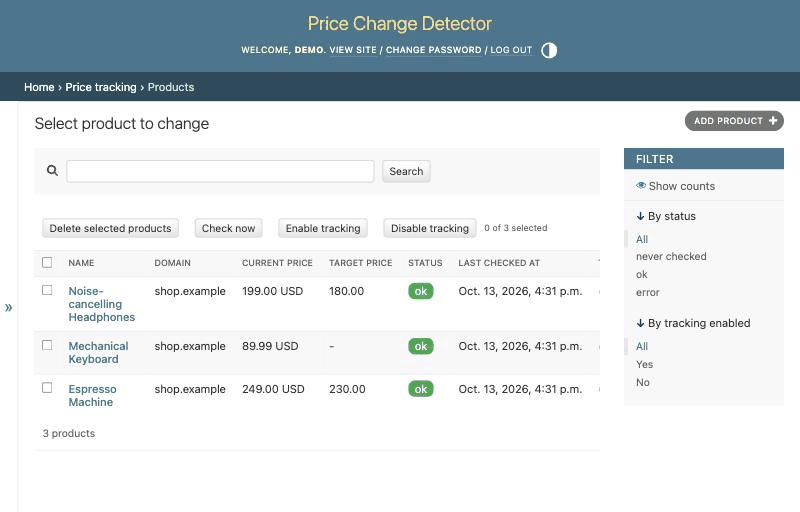

# Price Change Detector

[](https://github.com/sergeosn/price-change-detector/actions/workflows/ci.yml)

A personal, self-hosted service that tracks product prices on web pages by URL. A Django admin and a FastAPI REST API share one PostgreSQL database and one service layer; a separate scheduler process checks prices once a day and records every change.

## Demo



A product without structured price data fails its first check; the shop's domain rule is created automatically, and once a CSS selector and currency are set the product is re-checked and its price appears in CAD.

## Features

- Automatic price extraction: JSON-LD → microdata → OpenGraph, then a CSS selector of the product or of the shop.
- Price history: one record per price change.
- Shop currency (ISO 4217) detected from the page or set manually.
- Django admin: products, domain rules, price history, "check now" action.
- REST API protected by an `X-API-Key` header, Swagger UI at `/api/docs`.
- Product page text is stored in chunks with multilingual embeddings (pgvector) for retrieval.
- Hybrid search over the page text: by meaning (embeddings), by words and model numbers (full-text search, name trigrams), or both.
- Price change notifications go through a `Notifier` interface. The default implementation is a no-op; Telegram is used when `TELEGRAM_BOT_TOKEN` and `TELEGRAM_CHAT_ID` are set.

## Architecture

```
┌───────────── app (uvicorn) ─────────────┐     ┌──── scheduler ────┐
│ FastAPI  /api/v1/...                    │     │ manage.py         │
│   ├─ mount /admin  → Django ASGI        │     │   run_scheduler   │
│   └─ mount /static → StaticFiles        │     │                   │
└───────────────┬─────────────────────────┘     └────────┬──────────┘
                │      tracker.services (shared layer)   │
                └──────────────┬─────────────────────────┘
                 ┌─────────────┴──────────────┐
                 │ db: PostgreSQL 17          │
                 │   + pgvector, pg_trgm      │
                 └────────────────────────────┘
```

- **Django owns the models and migrations**; FastAPI uses the Django ORM, so models are never duplicated.
- **One service layer** (`src/tracker/services`) is called by the admin, the API and the scheduler.
- **PostgreSQL with pgvector** is the only supported database. A migration enables the `vector` and `pg_trgm` extensions. The app and the scheduler write concurrently: a check locks the product row (`SELECT … FOR UPDATE`) before comparing prices, so two simultaneous checks cannot record the same change twice.
- **The code is synchronous.** Django's async ORM still runs queries in threads and cannot use `transaction.atomic()`, so FastAPI endpoints are plain `def` functions executed in a thread pool.
- Page fetching (`PageFetcher`), embeddings (`Embedder`) and notifications (`Notifier`) sit behind interfaces and are replaced by fakes in tests.

## Quick start (Docker)

```bash
cp .env.example .env
```

Set `DJANGO_SECRET_KEY` and `API_KEY` in `.env`, then:

```bash
docker compose up -d --build
docker compose exec app python manage.py createsuperuser
```

This starts three services: `db` (PostgreSQL), `app` (applies migrations, then serves the API and the admin) and `scheduler`. `app` and `scheduler` wait until `db` is healthy.

- Admin: http://localhost:8000/admin/
- API docs: http://localhost:8000/api/docs

The data lives in the `pgdata` Docker volume and the downloaded embedding model in `model-cache`: `docker compose down` keeps them, `docker compose down -v` deletes them. PostgreSQL is published on `127.0.0.1:5432` only (database and user `pcd`); to change the default password, set `POSTGRES_PASSWORD` in `.env` before the first start.

## Local development

The code runs on the host and uses the PostgreSQL from Docker Compose; `DATABASE_URL` in `.env.example` already points at it.

```bash
uv sync
cp .env.example .env    # set DJANGO_SECRET_KEY and API_KEY
docker compose up -d db
uv run --env-file .env python src/manage.py migrate
uv run --env-file .env python src/manage.py createsuperuser
uv run --env-file .env python src/manage.py collectstatic --noinput
uv run --env-file .env uvicorn config.asgi:app --app-dir src --reload
```

Run the scheduler in another terminal (`--once` runs a single pass):

```bash
uv run --env-file .env python src/manage.py run_scheduler
```

To add many products at once, put their URLs in a text file, one per line. URLs that already exist and lines that are not http(s) URLs are skipped (the invalid ones are listed), and the command prints how many products it created, skipped and rejected. Nothing is fetched: the scheduler checks the new products on its next pass.

```bash
uv run --env-file .env python src/manage.py seed_products urls.txt
```

Every successful check also stores the page text (description and specifications) as a document split into chunks, rebuilt only when the text changes. For products added before that, fetch it once (`--all` refetches every product):

```bash
uv run --env-file .env python src/manage.py index_content
```

Chunks get their embeddings from a separate command. It embeds the chunks that have none, or whose embedding was made by a model other than `EMBEDDING_MODEL`, so it is also what you run after changing the model:

```bash
uv run --env-file .env python src/manage.py embed_chunks
```

The model (`intfloat/multilingual-e5-small`, 384 dimensions, about 470 MB) runs locally on the CPU and is downloaded from Hugging Face on first use: into `~/.cache/huggingface` on the host, into the `model-cache` volume in Docker (`docker compose exec app python manage.py embed_chunks`). The image installs the CPU-only build of PyTorch.

`export_corpus` writes `data/corpus.jsonl`: one JSON line per product with its `url`, `name`, `domain` and `text`, the first 1500 characters of its document (empty for a product without one). `--output` writes to another file.

```bash
uv run --env-file .env python src/manage.py export_corpus
```

## API examples

```bash
export API=http://localhost:8000/api/v1 KEY=your-api-key

# Shop rule: currency plus a selector for pages without structured data
curl -s -X POST $API/domain-rules -H "X-API-Key: $KEY" -H "Content-Type: application/json" \
  -d '{"domain": "amazon.ca", "currency": "CAD", "price_selector": "span.a-price span.a-offscreen"}'

# Add a product (checked immediately; pass "check_now": false to leave it to the scheduler)
curl -s -X POST $API/products -H "X-API-Key: $KEY" -H "Content-Type: application/json" \
  -d '{"url": "https://rozetka.com.ua/ua/apple-iphone-15/p395460480/", "target_price": "35000"}'

curl -s "$API/products?status=error" -H "X-API-Key: $KEY"      # products whose last check failed
curl -s $API/products/1/history -H "X-API-Key: $KEY"            # price history
curl -s -X POST $API/products/1/check -H "X-API-Key: $KEY"      # check now
curl -s -X PATCH $API/products/1 -H "X-API-Key: $KEY" -H "Content-Type: application/json" \
  -d '{"is_active": false}'

# Search the page text; mode is hybrid (default), lexical or vector
curl -s -G $API/search -H "X-API-Key: $KEY" --data-urlencode "q=WH-1000XM5" -d mode=hybrid -d limit=10
```

## Search

`GET /api/v1/search?q=...&mode=hybrid&limit=10` searches the chunks of the stored page text and returns one result per product: its best chunk with the score and the text.

| Mode | How it ranks | Score |
| --- | --- | --- |
| `vector` | Cosine distance between the query embedding and the chunk embeddings (HNSW index). Finds paraphrases and other languages. | Cosine similarity |
| `lexical` | PostgreSQL full-text search with the `simple` configuration (no stemming, any query word may match; GIN index on a stored `tsvector`) plus `pg_trgm` word similarity of the query to the product name (GIN trigram index). Finds exact words and model numbers. | Text rank + name similarity |
| `hybrid` | Reciprocal rank fusion of the two rankings: a chunk gets `1 / (60 + rank)` from each. | Sum of both |

Scores are comparable only within one response. Vector and hybrid search need embeddings (`embed_chunks`) and load the embedding model on the first query; lexical search needs neither. A product without stored page text is not found.

## Search quality

`evals/search_queries.jsonl` holds labelled queries, one JSON object per line: `{"query", "kind", "relevant": [urls]}`. The URLs are products of `data/corpus.jsonl`, so the database has to hold that corpus with its embeddings.

| Kind | Query | Relevant |
| --- | --- | --- |
| `model_number` | A model or article number from a product's name or text | That product, and the same product in other shops |
| `description` | What a buyer would type, in Ukrainian, Russian or English | Every product that fits |
| `cross_shop` | The full name of a product as one shop writes it | The same product in the other shop |

The file has 20 `model_number` and 20 `description` queries. It has no `cross_shop` queries yet: the two shops of the current corpus sell no product in common.

`eval_search` runs every query in the `vector`, `lexical` and `hybrid` modes and prints a table per mode, overall and per kind. No LLM is involved: a result counts when its URL is in `relevant`.

```bash
uv run --env-file .env python src/manage.py eval_search evals/search_queries.jsonl
```

- **recall@k** — the share of the relevant products found in the top `k`, out of those that fit there (with three relevant products recall@1 is 1 when the first result is one of them).
- **MRR** — the mean of `1 / rank` of the first relevant result among the top 10; 0 when there is none.
- **p50, p95** — latency percentiles of the whole search call, the query embedding included. One unmeasured query per mode comes first, so loading the model is not counted.

The numbers are also written as JSON next to the input file (`evals/search_queries.results.json`); `--output` writes them elsewhere. In Docker `./evals` is mounted into the containers, so the same file appears on the host:

```bash
docker compose exec app python manage.py eval_search /app/evals/search_queries.jsonl
```

Results on 152 products (77 from `princessauto.com`, 75 from `autoshack.ca`) and 40 queries (20 `model_number`, 20 `description`), with `intfloat/multilingual-e5-small` embeddings and the top 10 results per query:

| Mode | Kind | Queries | Recall@1 | Recall@5 | MRR | p50, ms | p95, ms |
| --- | --- | --- | --- | --- | --- | --- | --- |
| `vector` | overall | 40 | 0.475 | 0.615 | 0.562 | 15.4 | 48.8 |
| `vector` | `model_number` | 20 | 0.550 | 0.700 | 0.632 | 15.1 | 65.5 |
| `vector` | `description` | 20 | 0.400 | 0.529 | 0.492 | 16.3 | 19.2 |
| `lexical` | overall | 40 | 0.600 | 0.594 | 0.604 | 4.3 | 6.2 |
| `lexical` | `model_number` | 20 | 1.000 | 1.000 | 1.000 | 4.1 | 4.8 |
| `lexical` | `description` | 20 | 0.200 | 0.188 | 0.207 | 4.7 | 6.2 |
| `hybrid` | overall | 40 | 0.650 | 0.733 | 0.706 | 19.8 | 77.6 |
| `hybrid` | `model_number` | 20 | 0.950 | 1.000 | 0.963 | 17.6 | 65.6 |
| `hybrid` | `description` | 20 | 0.350 | 0.467 | 0.450 | 20.2 | 80.4 |

## How prices and currencies are extracted

1. The page is downloaded with a plain HTTP request (JavaScript is not executed).
2. The price is looked up in order: JSON-LD `Product` → microdata `itemprop="price"` → OpenGraph `product:price:amount` → CSS selector (the product's selector first, then the domain rule's).
3. The currency belongs to the shop (`DomainRule.currency`). It is taken only from an explicit ISO code on the page (`priceCurrency`, `CAD 15.99`); symbols such as `$` are ambiguous and ignored. If the page states a code and the shop has no currency yet, it is saved automatically; if the code differs from the saved one, the check fails with `Currency mismatch`.
4. A history record is created only when the price actually changes.

## Telegram notifications

1. Create a bot with [@BotFather](https://t.me/BotFather) and copy its token.
2. Send the bot any message, then find your `chat_id` at `https://api.telegram.org/bot<TOKEN>/getUpdates`.
3. Set `TELEGRAM_BOT_TOKEN` and `TELEGRAM_CHAT_ID` in `.env` and restart the services.

The bot reports every price change (except the first price found) and highlights when the target price is reached.

## Configuration

All settings are environment variables; see [.env.example](.env.example) for the full list.

### CORS (browser frontends)

A frontend served from another origin can call the API once that origin is listed in `CORS_ALLOWED_ORIGINS` (comma-separated; empty disables CORS):

```dotenv
CORS_ALLOWED_ORIGINS=http://localhost:5173,http://localhost:4173
```

Allowed methods are `GET`, `POST`, `PATCH`, `DELETE`; allowed headers are `X-API-Key` and `Content-Type`; cookies are not used. The API key sent from browser JavaScript is visible to anyone using that page, so expose the API to a browser frontend only for personal or local use.

## Tests and code quality

```bash
docker compose up -d db
uv run pytest --cov
uv run ruff check . && uv run ruff format --check .
```

Tests run on PostgreSQL: pytest creates and drops its own `test_pcd` database on the Compose `db` service, so development data is not touched. Set `TEST_DATABASE_URL` to use another server (the role must be allowed to create databases and the `vector` extension). CI starts the same `pgvector/pgvector:pg17` image as a service.

Tests never touch the network: page downloads are replaced by fakes or `respx`, and embeddings by a fake embedder, so no model is ever downloaded.

## Project layout

```
src/
  config/          Django settings, ASGI assembly
  tracker/         models, admin, services, management commands (run_scheduler, seed_products, ...)
  api/             FastAPI: schemas, dependencies, routers
  notifications/   notifier interface and Telegram
evals/             labelled search queries for eval_search
tests/
  unit/            pure logic and services
  integration/     API, admin, fetcher, scheduler
```

## Limitations

- Shops that render prices with JavaScript (SPAs) are not supported.
- Single user, single API key.
- One check interval for all products (`CHECK_INTERVAL_HOURS`).

## License

Released under the [MIT License](LICENSE).
