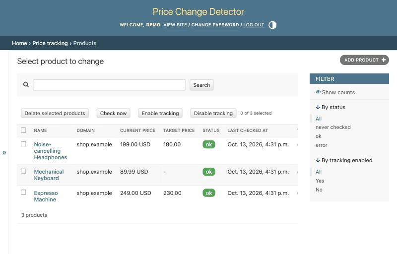

# Price Change Detector

[](https://github.com/sergeosn/price-change-detector/actions/workflows/ci.yml)

A personal, self-hosted service that tracks product prices on web pages by URL. A Django admin and a FastAPI REST API share one database and one service layer; a separate scheduler process checks prices once a day and records every change.

## Demo



A product without structured price data fails its first check; the shop's domain rule is created automatically, and once a CSS selector and currency are set the product is re-checked and its price appears in CAD.

## Features

- Automatic price extraction: JSON-LD → microdata → OpenGraph, then a CSS selector of the product or of the shop.
- Price history: one record per price change.
- Shop currency (ISO 4217) detected from the page or set manually.
- Django admin: products, domain rules, price history, "check now" action.
- REST API protected by an `X-API-Key` header, Swagger UI at `/api/docs`.
- Price change notifications go through a `Notifier` interface. The default implementation is a no-op; Telegram is used when `TELEGRAM_BOT_TOKEN` and `TELEGRAM_CHAT_ID` are set.

## Architecture

```
┌───────────── app (uvicorn) ─────────────┐     ┌──── scheduler ────┐
│ FastAPI  /api/v1/...                    │     │ manage.py         │
│   ├─ mount /admin  → Django ASGI        │     │   run_scheduler   │
│   └─ mount /static → StaticFiles        │     │                   │
└───────────────┬─────────────────────────┘     └────────┬──────────┘
                │      tracker.services (shared layer)   │
                └──────────────┬─────────────────────────┘
                        SQLite (WAL), ./data/db.sqlite3
```

- **Django owns the models and migrations**; FastAPI uses the Django ORM, so models are never duplicated.
- **One service layer** (`src/tracker/services`) is called by the admin, the API and the scheduler.
- **The code is synchronous.** Django's async ORM still runs queries in threads and cannot use `transaction.atomic()`, so FastAPI endpoints are plain `def` functions executed in a thread pool.
- Page fetching (`PageFetcher`) and notifications (`Notifier`) sit behind interfaces and are replaced by fakes in tests.

## Quick start (Docker)

```bash
cp .env.example .env
```

Set `DJANGO_SECRET_KEY` and `API_KEY` in `.env`, then:

```bash
docker compose up -d --build
docker compose exec app python manage.py createsuperuser
```

- Admin: http://localhost:8000/admin/
- API docs: http://localhost:8000/api/docs

The database lives in `./data`. On Linux the containers run as UID 1000; if your UID differs, run `sudo chown 1000:1000 data`.

## Local development

```bash
uv sync
cp .env.example .env    # set DJANGO_SECRET_KEY and API_KEY
uv run --env-file .env python src/manage.py migrate
uv run --env-file .env python src/manage.py createsuperuser
uv run --env-file .env python src/manage.py collectstatic --noinput
uv run --env-file .env uvicorn config.asgi:app --app-dir src --reload
```

Run the scheduler in another terminal (`--once` runs a single pass):

```bash
uv run --env-file .env python src/manage.py run_scheduler
```

## API examples

```bash
export API=http://localhost:8000/api/v1 KEY=your-api-key

# Shop rule: currency plus a selector for pages without structured data
curl -s -X POST $API/domain-rules -H "X-API-Key: $KEY" -H "Content-Type: application/json" \
  -d '{"domain": "amazon.ca", "currency": "CAD", "price_selector": "span.a-price span.a-offscreen"}'

# Add a product (checked immediately; pass "check_now": false to leave it to the scheduler)
curl -s -X POST $API/products -H "X-API-Key: $KEY" -H "Content-Type: application/json" \
  -d '{"url": "https://rozetka.com.ua/ua/apple-iphone-15/p395460480/", "target_price": "35000"}'

curl -s "$API/products?status=error" -H "X-API-Key: $KEY"      # products whose last check failed
curl -s $API/products/1/history -H "X-API-Key: $KEY"            # price history
curl -s -X POST $API/products/1/check -H "X-API-Key: $KEY"      # check now
curl -s -X PATCH $API/products/1 -H "X-API-Key: $KEY" -H "Content-Type: application/json" \
  -d '{"is_active": false}'
```

## How prices and currencies are extracted

1. The page is downloaded with a plain HTTP request (JavaScript is not executed).
2. The price is looked up in order: JSON-LD `Product` → microdata `itemprop="price"` → OpenGraph `product:price:amount` → CSS selector (the product's selector first, then the domain rule's).
3. The currency belongs to the shop (`DomainRule.currency`). It is taken only from an explicit ISO code on the page (`priceCurrency`, `CAD 15.99`); symbols such as `$` are ambiguous and ignored. If the page states a code and the shop has no currency yet, it is saved automatically; if the code differs from the saved one, the check fails with `Currency mismatch`.
4. A history record is created only when the price actually changes.

## Telegram notifications

1. Create a bot with [@BotFather](https://t.me/BotFather) and copy its token.
2. Send the bot any message, then find your `chat_id` at `https://api.telegram.org/bot<TOKEN>/getUpdates`.
3. Set `TELEGRAM_BOT_TOKEN` and `TELEGRAM_CHAT_ID` in `.env` and restart the services.

The bot reports every price change (except the first price found) and highlights when the target price is reached.

## Configuration

All settings are environment variables; see [.env.example](.env.example) for the full list.

### CORS (browser frontends)

A frontend served from another origin can call the API once that origin is listed in `CORS_ALLOWED_ORIGINS` (comma-separated; empty disables CORS):

```dotenv
CORS_ALLOWED_ORIGINS=http://localhost:5173,http://localhost:4173
```

Allowed methods are `GET`, `POST`, `PATCH`, `DELETE`; allowed headers are `X-API-Key` and `Content-Type`; cookies are not used. The API key sent from browser JavaScript is visible to anyone using that page, so expose the API to a browser frontend only for personal or local use.

## Tests and code quality

```bash
uv run pytest --cov
uv run ruff check . && uv run ruff format --check .
```

Tests never touch the network: page downloads are replaced by fakes or `respx`.

## Project layout

```
src/
  config/          Django settings, ASGI assembly
  tracker/         models, admin, services, run_scheduler command
  api/             FastAPI: schemas, dependencies, routers
  notifications/   notifier interface and Telegram
tests/
  unit/            pure logic and services
  integration/     API, admin, fetcher, scheduler
```

## Limitations

- Shops that render prices with JavaScript (SPAs) are not supported.
- Single user, single API key.
- One check interval for all products (`CHECK_INTERVAL_HOURS`).

## License

Released under the [MIT License](LICENSE).
